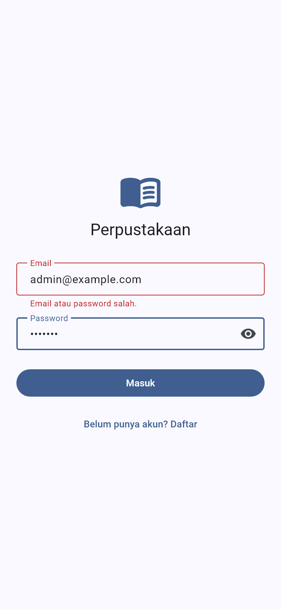
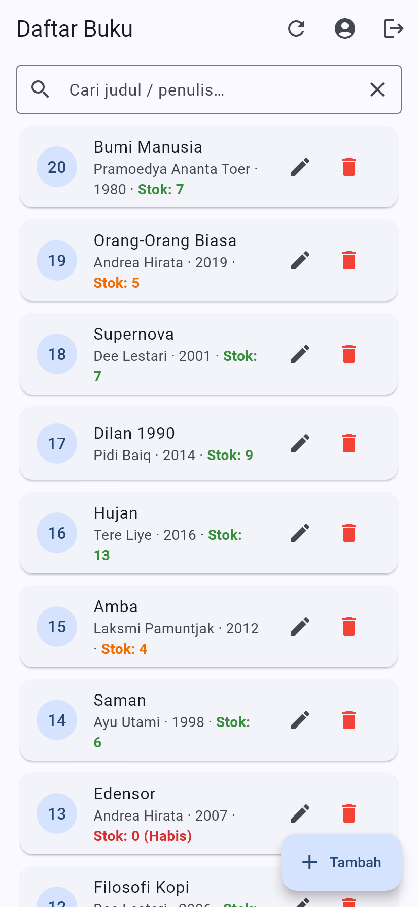
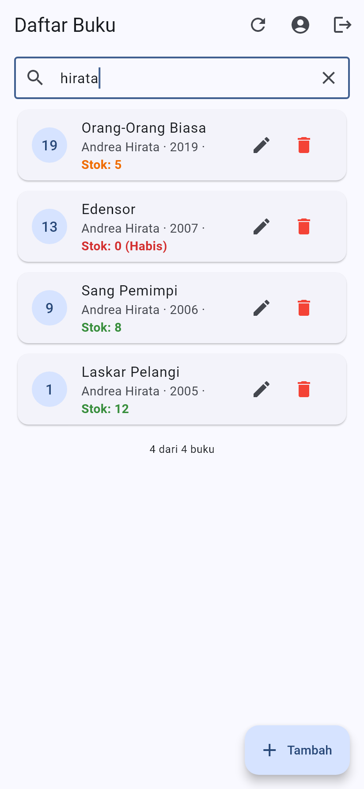
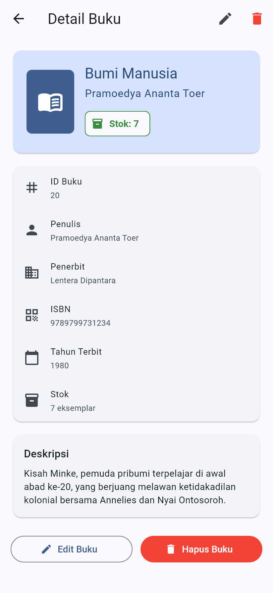
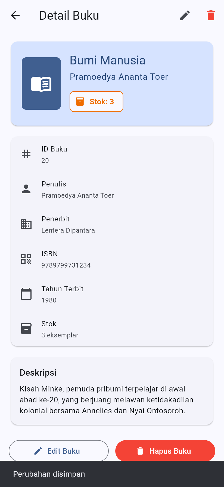
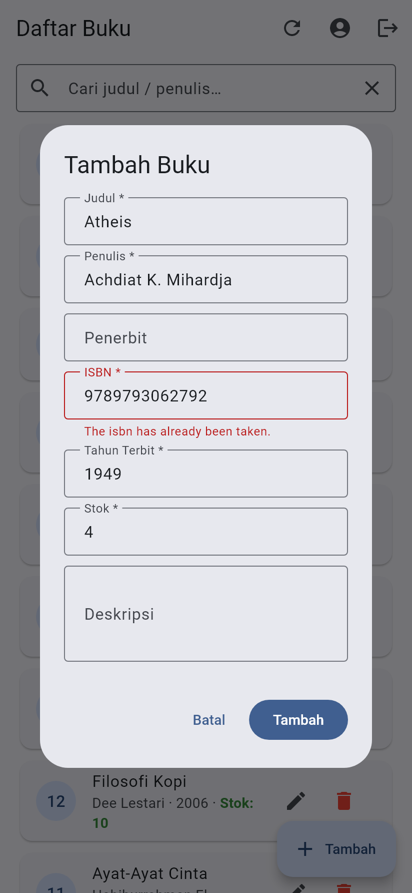
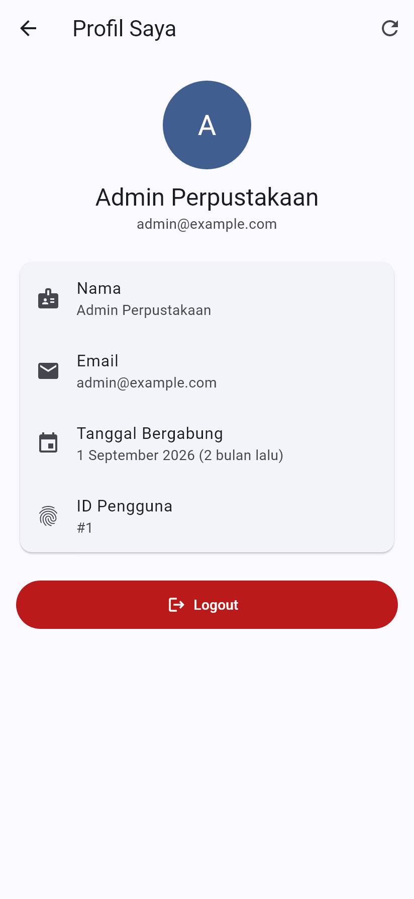
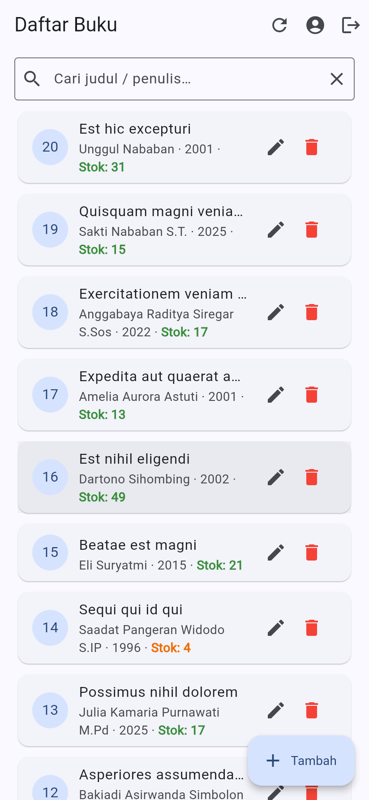
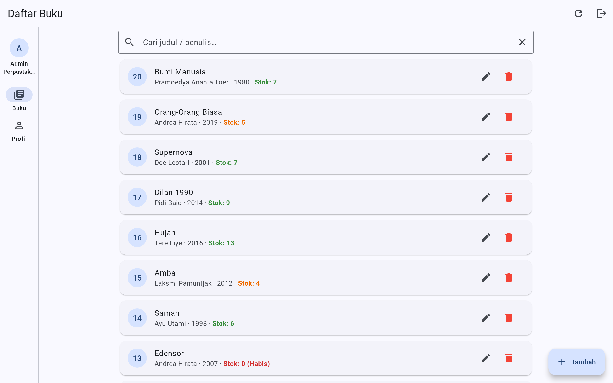
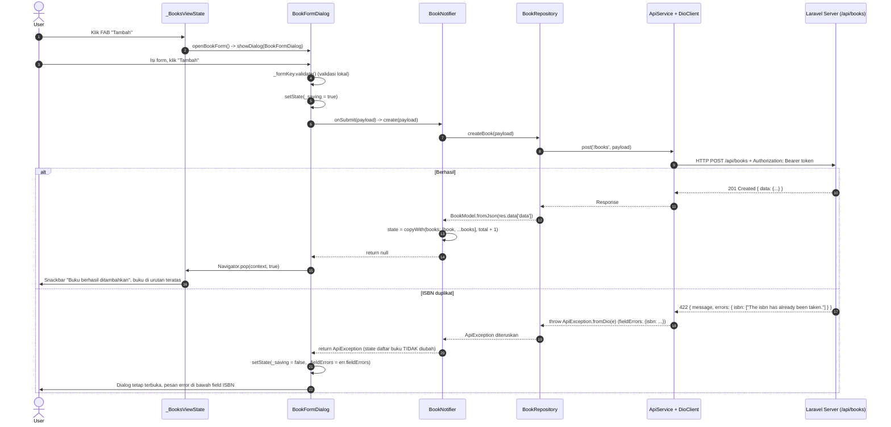

# Perpustakaan – Flutter + REST API Laravel (Sesi 11)

Hasil praktikum dan tugas **Mobile Programming Sesi 11**: aplikasi Flutter *Perpustakaan* yang terhubung ke REST API Laravel 12 (`perpus-api`) dengan autentikasi **Laravel Sanctum**, arsitektur **MVVM**, state management **Riverpod 3** dan HTTP client **Dio 5**. Aplikasi berjalan di **Android** dan **Web** dari satu codebase.

| | |
|---|---|
| Nama | Ahmad Mofidur Robbiyal Aqla |
| NIM | 2495114006 |
| Kelas | 5 - A |
| Mata kuliah | Mobile Programming |
| Backend | `perpus-api` (Laravel 12 + Sanctum + L5-Swagger) – [Pemograman-Web-Lanjut-sesi-11](https://github.com/RequimeOfficial/Pemograman-Web-Lanjut-sesi-11) |

## Isi repository

| Folder | Isi |
|---|---|
| `lib/` | Kode aplikasi (praktikum bab 4–13 + Latihan 3 + Tugas A, B, C) |
| `test/widget_test.dart` | 7 test bawaan modul (parsing respons, ApiException, BookNotifier, form buku) |
| `test/tugas_test.dart` | 11 test baru untuk Latihan 3 dan Tugas A, B, C |
| `screenshots/` | 14 tangkapan layar (HP + desktop/web) |
| `screenshots/api_asli/` | 6 tangkapan layar Flutter Web saat terhubung ke backend asli + `network_log.txt` |
| `video/demo_perpustakaan.mp4` | Video demo jalannya aplikasi (± 1 menit 44 detik) |
| `laporan/` | Laporan hasil praktikum dan tugas (`.docx` dan `.pdf`) |

## Fitur

**Praktikum (bagian 4–14 modul)**

| Fitur | Endpoint |
|---|---|
| Registrasi akun | `POST /api/register` |
| Login & simpan token (SharedPreferences) | `POST /api/login` |
| Login otomatis saat aplikasi dibuka (SplashView) | `GET /api/me` |
| Logout (token lokal selalu dihapus) | `POST /api/logout` |
| Daftar buku + pencarian + infinite scroll + pull-to-refresh | `GET /api/books?search=&page=&per_page=` |
| Tambah / edit / hapus buku | `POST` / `PUT` / `DELETE /api/books/{id}` |
| Error 422 tampil per field, 401 → kembali ke login, pesan koneksi yang ramah | `ApiException` + interceptor Dio |
| UI responsif: < 768 px tampilan HP (FAB), ≥ 768 px tampilan desktop (NavigationRail) | `ResponsiveLayout` |

**Latihan & Tugas**

| | Implementasi |
|---|---|
| Latihan 3 – warna stok | `lib/widgets/stock_style.dart` – merah `Stok: 0 (Habis)`, oranye 1–5, hijau > 5; dipakai di `BookCard` dan halaman detail |
| Tugas A – Detail Buku | `lib/views/books/book_detail_view.dart` (ConsumerWidget), route `AppRoutes.bookDetail` dengan `arguments: book`. Tombol Edit memanggil `bookProvider.notifier.update(...)`, Hapus memanggil `.delete(...)` lalu `Navigator.pop`. Detail membaca versi terbaru buku dari `bookProvider`, jadi setelah diedit tampilannya langsung ikut berubah |
| Tugas B – Profil User | `lib/views/profile/profile_view.dart` + `lib/viewmodels/profile_vm.dart` (`FutureProvider` → `AuthRepository.getProfile()` → `GET /api/me`). Menampilkan nama, email, tanggal bergabung (`created_at` → `UserModel.createdAt`) dan tombol Logout. Tujuan **Profil** ada di NavigationRail (desktop) dan tombol profil di AppBar (HP) |
| Tugas C – Debounce | `BooksView._onSearchChanged`: `Timer` 500 ms dibatalkan setiap ada huruf baru, sehingga request hanya dikirim setelah pengguna berhenti mengetik. Enter dan tombol hapus tetap mencari langsung |

Supaya tidak ada kode duplikat, dialog tambah/edit/hapus dipindah ke `lib/views/books/book_actions.dart` (dipakai `BooksView` dan `BookDetailView`) dan logout ke `lib/views/common/session_actions.dart` (dipakai `BooksView` dan `ProfileView`). View tetap tidak memanggil Dio/Repository secara langsung.

## Struktur kode

```
lib/
  core/
    constants/api_constants.dart   base URL per platform & path endpoint
    network/dio_client.dart        Dio + interceptor token & 401
    network/api_exception.dart     terjemahan error API (422, 401, koneksi)
    routes/app_router.dart         nama route + navigatorKey
    theme/app_theme.dart           tema Material 3
    utils/date_format.dart         format tanggal Indonesia (Tugas B)
  models/        user_model.dart, book_model.dart (BookModel + BookPage)
  services/      storage_service.dart, api_service.dart
  repositories/  auth_repository.dart, book_repository.dart
  viewmodels/    providers.dart, auth_vm.dart, book_vm.dart, profile_vm.dart
  views/
    auth/        splash_view.dart, login_view.dart, register_view.dart
    books/       books_view.dart, book_form_dialog.dart,
                 book_detail_view.dart (Tugas A), book_actions.dart
    profile/     profile_view.dart (Tugas B)
    common/      session_actions.dart
  widgets/       responsive_layout.dart, auth_scaffold.dart, book_card.dart,
                 stock_style.dart (Latihan 3)
  main.dart
```

## Cara menjalankan

1. Jalankan backend `perpus-api`:

   ```bash
   cd perpus-api
   php artisan migrate:fresh --seed
   php artisan serve
   ```

   Akun demo: `admin@example.com` / `password`. Dokumentasi API: http://localhost:8000/api/documentation

2. Jalankan aplikasi Flutter:

   ```bash
   flutter pub get
   flutter run -d chrome          # web  -> http://localhost:8000/api
   flutter run -d emulator-5554   # emulator Android -> http://10.0.2.2:8000/api
   ```

   HP fisik: jalankan backend dengan `php artisan serve --host=0.0.0.0` lalu
   `flutter run --dart-define=API_BASE_URL=http://<IP-LAPTOP>:8000/api`.

3. Verifikasi kode:

   ```bash
   flutter analyze            # No issues found!
   flutter test               # All tests passed! (18 test)
   flutter build apk --debug
   ```

## Hasil pengujian

### Checklist uji manual (bagian 14.6)

| No | Skenario | Hasil | Bukti |
|---|---|---|---|
| 1 | Login dengan password salah | Pesan "Email atau password salah." di bawah field Email | `02_login_gagal_422.png` |
| 2 | Login `admin@example.com` / `password` | Masuk ke Daftar Buku | `api_asli/r1_daftar_buku_api_asli.png` |
| 3 | Scroll sampai bawah | Halaman berikutnya dimuat, footer "20 dari 20 buku" | `04_infinite_scroll.png` |
| 4 | Tambah buku dengan ISBN yang sudah ada | Dialog tetap terbuka, error di field ISBN | `api_asli/r6_tambah_isbn_duplikat_422.png` |
| 5 | Tambah buku dengan ISBN baru | Buku muncul di atas daftar + snackbar | `10_tambah_berhasil.png` |
| 6 | Edit stok buku | Stok berubah + snackbar "Perubahan disimpan" | `07_detail_setelah_edit.png` |
| 7 | Cari judul | Daftar hanya berisi buku yang cocok | `api_asli/r2_pencarian_debounce_api_asli.png` |
| 8 | Hapus buku | Buku hilang dari daftar + snackbar | `08_konfirmasi_hapus.png`, video |
| 9 | Reload browser | Langsung masuk ke Daftar Buku (GET /api/me) tanpa login | diuji di browser |
| 10 | Register dengan email yang sudah terdaftar | Pesan error di bawah field Email | `api_asli/r5_register_email_duplikat_422.png` |
| 11 | Logout | Kembali ke halaman login | video |
| 12 | Lebar < 768 px dan ≥ 768 px | Tampilan HP (FAB) dan desktop (NavigationRail) | `03_…` vs `12_desktop_daftar_buku.png` |

Pengujian dengan backend asli dilakukan memakai `flutter build web` yang dibuka di Chrome dan terhubung ke `perpus-api` di `localhost:8000`. Log request-nya ada di [`screenshots/api_asli/network_log.txt`](screenshots/api_asli/network_log.txt): mengetik kata "dolore" (6 huruf) hanya menghasilkan **satu** request `GET /api/books?search=dolore`, yang membuktikan debounce Tugas C bekerja.

### Screenshot

| Login gagal (422) | Daftar buku + warna stok | Pencarian (debounce) | Detail buku (Tugas A) |
|---|---|---|---|
|  |  |  |  |

| Setelah edit dari detail | ISBN duplikat (422) | Profil (Tugas B) | Backend asli |
|---|---|---|---|
|  |  |  |  |

Tampilan desktop/web (≥ 768 px):



## Latihan 2 – Tracing alur data Tambah Buku (termasuk 422)



## Pertanyaan analisis – mengapa `BookNotifier` memakai `_requestId`?

Setiap pemanggilan `load()` menaikkan `_requestId` dan menyimpan nilainya di variabel lokal `id`. Saat respons datang, kode memeriksa `if (id != _requestId) return;`, artinya hanya respons dari request **terakhir** yang boleh mengubah state.

Tanpa `_requestId`, misalnya pengguna mencari "a" lalu cepat mengganti menjadi "ab":

1. Request #1 (`search=a`) dikirim, lalu request #2 (`search=ab`) dikirim.
2. Respons #2 datang lebih dulu → daftar menampilkan hasil "ab" (benar).
3. Respons #1 datang belakangan (misalnya karena server lebih lambat untuk hasil yang lebih banyak) → daftar **ditimpa** hasil "a", padahal kolom pencarian berisi "ab".

Hasilnya pengguna melihat data yang tidak sesuai kata kunci (*race condition*), dan `state.search`/paginasi ikut kacau karena `loadMore()` melanjutkan halaman dari hasil yang salah. Dengan `_requestId`, respons #1 dikenali sebagai respons usang dan diabaikan. `reset()` saat logout juga menaikkan `_requestId` supaya respons yang masih dalam perjalanan tidak mengisi data ke akun berikutnya. Skenario ini diuji di `test/tugas_test.dart` (test `_requestId: respons pencarian lama yang datang belakangan diabaikan`).

Debounce (Tugas C) mengurangi jumlah request, tetapi tidak menghapus kebutuhan `_requestId`: jeda mengetik lebih dari 500 ms tetap bisa menghasilkan dua request yang responsnya datang tidak berurutan.
